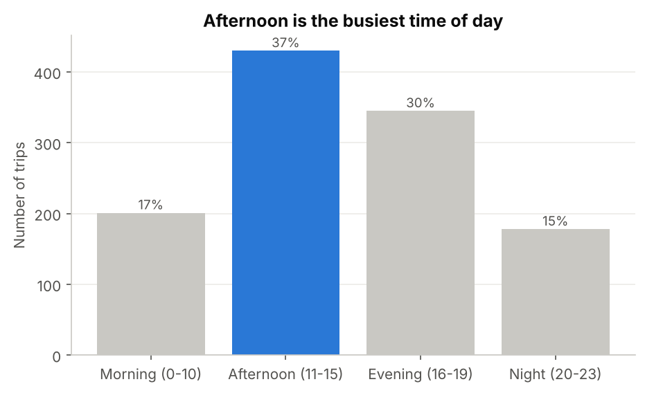
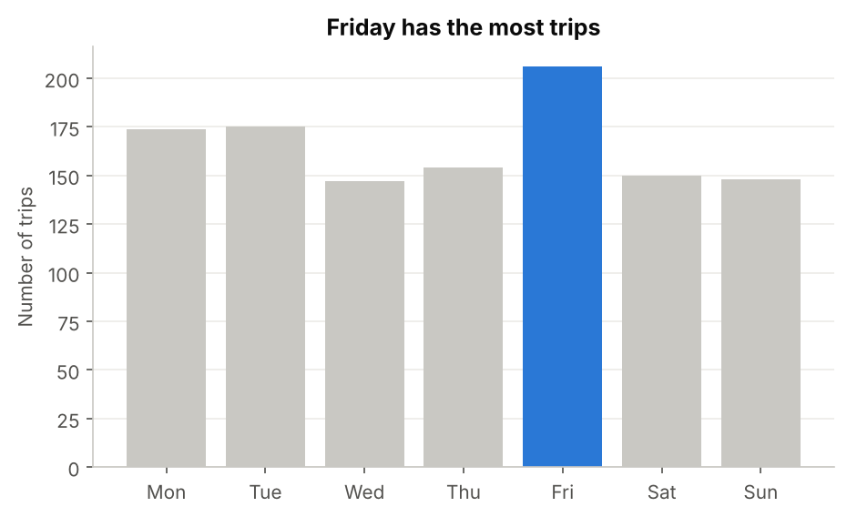
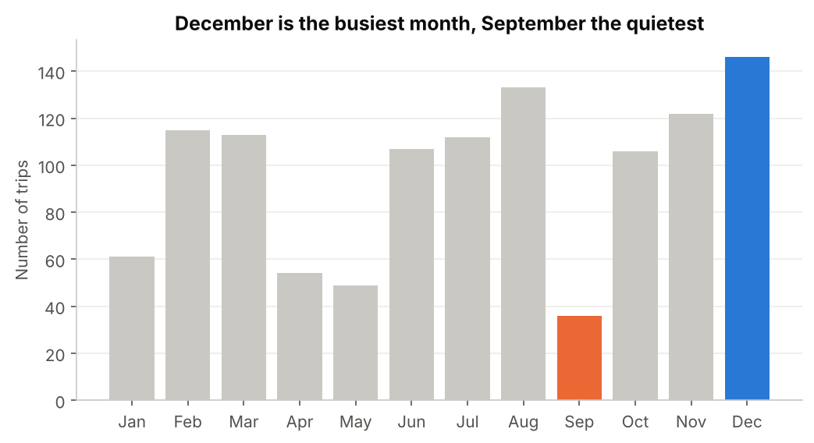
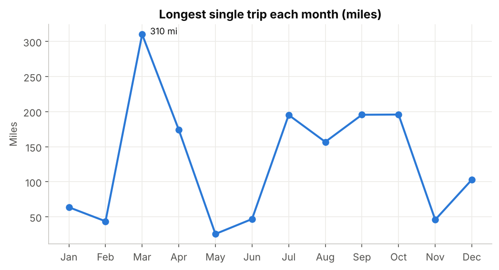
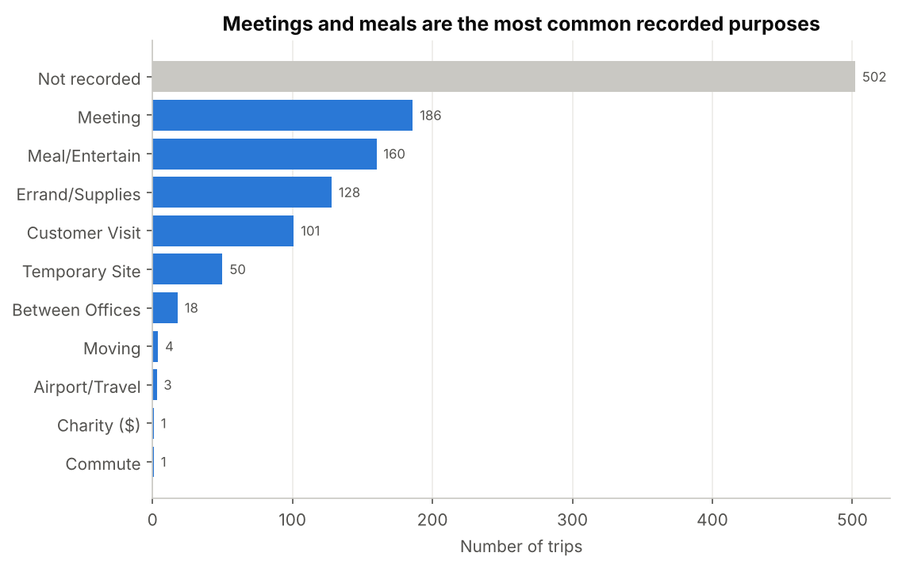
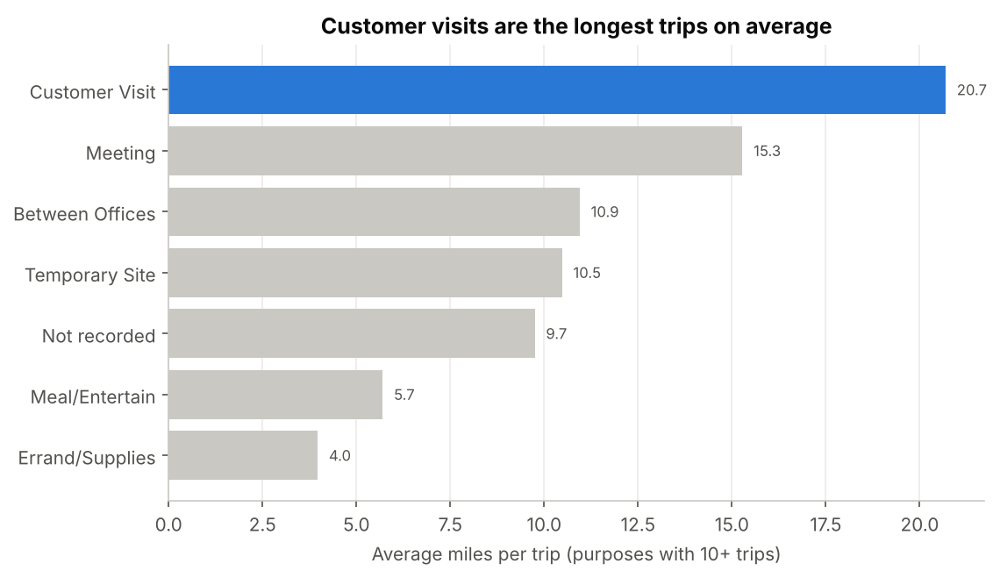
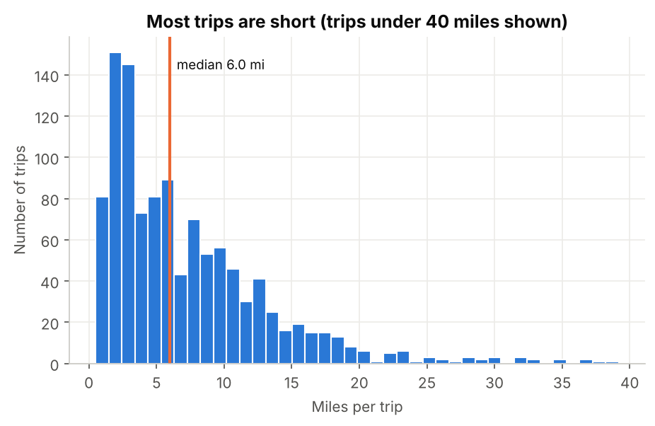
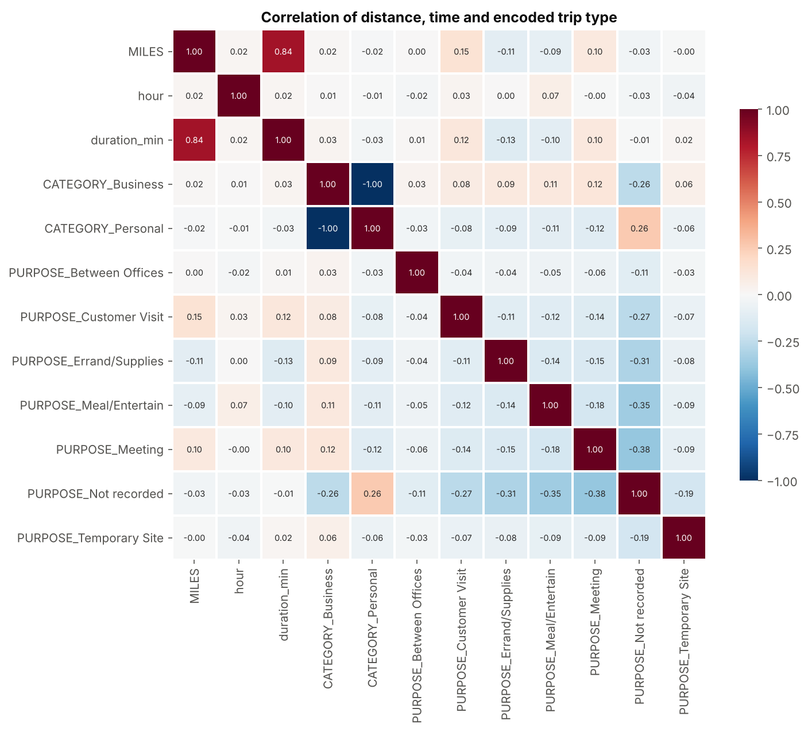

# Uber Trip Data Analysis

An end-to-end Python exploratory analysis of one year of Uber trip logs (Jan–Dec 2016, 1,154 trips, 12,195 miles) that shows when rides are needed, what they are used for, and which trips cover the most distance.

🌐 **Part of my data analytics portfolio:** [ayshashamamusamil.netlify.app](https://ayshashamamusamil.netlify.app/)

## Tech Skills


## Problem

A ride-hailing operator has to put drivers in the right place at the right time. Raw trip logs (start and end times, category, purpose, miles) don't answer the planning questions on their own:

1. **When** is demand highest — by time of day, weekday and month?
2. **What** are rides used for, and how much is business vs personal?
3. **Which** trip types cover the longest distances, and how common are long trips?

## Solution

A reproducible Python pipeline ([`src/uber_analysis.py`](src/uber_analysis.py)) that cleans the raw log, engineers time features, and produces 8 charts answering each question.

**Data preprocessing**

1. Removed the `Totals` summary row at the end of the file (it is not a trip).
2. Parsed `START_DATE` and `END_DATE`, which arrive in **two different formats** (`01-13-2016 13:00` and `1/13/2016 13:00`), using mixed-format parsing.
3. Labelled the 502 trips with no purpose as `Not recorded` instead of dropping them.
4. Dropped rows with missing dates or category, and removed 1 duplicate trip.
5. Created features: hour, time-of-day band (Morning / Afternoon / Evening / Night), weekday, month and trip duration in minutes.
6. One-hot encoded `CATEGORY` and `PURPOSE` (Scikit-learn `OneHotEncoder`) to build a correlation matrix.

## Key Metrics Tracked

- Trips by purpose, category, time of day, weekday and month
- Total and median miles; share of short trips
- Longest single trip per month
- Average miles per trip by purpose
- Correlation between distance, duration, hour and encoded trip type

## Screenshots

### Demand by time of day and weekday
<p>


</p>

### Demand across the year
<p>


</p>

### What trips are used for
<p>


</p>

### Distance and correlation




## Key Insights Found

- **Rides are overwhelmingly for business.** 93.3% of trips are Business. Of trips with a recorded purpose, Meetings (186) and Meal/Entertain (160) lead.
- **Afternoon is the peak.** 37% of trips start between 11:00 and 15:59, and another 30% between 16:00 and 19:59, so two-thirds of demand falls between late morning and early evening.
- **Friday is the busiest day.** Friday has 206 trips, about 30% more than the next busiest days (Monday 174, Tuesday 175). Wednesday is the quietest at 147.
- **Demand is seasonal.** December (146) and August (133) are the busiest months; September (36), May (49) and April (54) are the quietest.
- **Most trips are short, a few are very long.** The median trip is 6.0 miles and 72% are under 10 miles, but the longest reaches 310 miles (March). Distance and duration move together strongly (correlation 0.84), while trip type barely predicts distance (all correlations below 0.2).
- **Customer visits travel furthest.** They average 20.7 miles per trip, against 4.0 miles for errands and 5.7 for meals.

## Recommendations

1. **Staff for the 11:00–20:00 window**, with extra driver supply on Fridays.
2. **Use the September and April–May dip** for driver onboarding, training and vehicle maintenance.
3. **Offer a business account or loyalty programme**, since business riders make 93% of trips.
4. **Price and route long customer-visit trips separately**; they are 3 to 5 times longer than meal or errand trips.
5. **Make trip purpose easier to record**: 43.5% of trips have none, which limits purpose-based targeting such as discounts for frequent meal riders.

## Data Limitations

- The data covers **one rider's account for one year**, so it shows that rider's patterns, not city-wide demand.
- 43.5% of trips have no recorded purpose; purpose-level results describe only the 652 trips that have one.
- There is no fare data, so revenue cannot be analysed.

## What changed in v2

The first version parsed dates with the default parser, which silently failed on one of the two date formats and dropped about 735 of the 1,155 trips. v2 parses both formats, keeps all 1,154 valid trips, and updates every chart and insight. The weekday and month findings changed as a result (for example, December, not November, is the busiest month).

## Tech Stack

- **Python** — main language
- **Pandas, NumPy** — cleaning, feature engineering, aggregation
- **Matplotlib, Seaborn** — visualisation
- **Scikit-learn** — one-hot encoding for the correlation analysis
- **VS Code, PowerShell, Excel** — development, running scripts, first look at the data

## Project Structure

```
uber-trip-data-analysis-project/
├── data/UberDataset.csv        # raw trip log (1,155 trips + totals row)
├── src/uber_analysis.py        # cleaning, features, charts
├── screenshots/                # charts generated by the script
└── README.md
```

## How to Run

```bash
pip install pandas numpy matplotlib seaborn scikit-learn
python src/uber_analysis.py
```

The charts are written to `screenshots/` and the summary numbers are printed to the console.

## Future Improvements

- Build an interactive Power BI version with slicers for month, purpose and time of day.
- Map start and stop locations to find the busiest pickup areas.
- Forecast weekly trip volume to plan driver supply.

## Author

**Aysha Shama** · Data Analyst

[](https://ayshashamamusamil.netlify.app/)
[](https://www.linkedin.com/in/aysha-shama-b5029a229/)
[](mailto:ayshashama003@gmail.com)
[](https://github.com/ayshashama-portfolio)

